# di-agent: subtasks and diagrams

This page splits di-agent into six subtasks and draws each one: what runs, what it reads, what it writes, and how a scenario unfolds. Every diagram was drawn from the code, not from the prose elsewhere in the repository; file references are relative to `semantic-map/go/`. When the code changes a flow drawn here, change the diagram in the same commit.

The design record — why things are the way they are — stays in [`semantic-map/ARCHITECTURE.md`](../semantic-map/ARCHITECTURE.md). This page is the map of the territory; that one is the reasoning.

## Contents

- [1. The six subtasks](#1-the-six-subtasks)
- [2. The whole agent](#2-the-whole-agent) — context, components, loops
- [3. Self-knowledge: the Semantic Map](#3-self-knowledge-the-semantic-map)
- [4. Local adaptation: relief](#4-local-adaptation-relief)
- [5. Task offloading: admission](#5-task-offloading-admission)
- [6. Networking and coordination](#6-networking-and-coordination)
- [7. Trust and security](#7-trust-and-security)
- [8. Autonomy and governance](#8-autonomy-and-governance)
- [9. Deployments](#9-deployments)

---

## 1. The six subtasks

di-agent is one daemon per machine. It models its own system and acts on that model. The work divides into six subtasks, each answering one question:

| # | Subtask | The question it answers | Packages |
|---|---|---|---|
| S1 | **Self-knowledge** | What is this node, what runs on it, and how do its properties relate? | `statemap`, `semmap`, `collectors`, `facts`, `runtime`, `groups`, `internal/minimal` (proposer) |
| S2 | **Local adaptation** | Can I relieve pressure here, without moving work? | `relief`, `actuators`, `policy` |
| S3 | **Task offloading** | Should I accept this work — and if not, who should? | `admission`, `agentmain/admission.go` |
| S4 | **Networking and coordination** | How do nodes find each other and learn what the others know? | `peers`, `statemap` (`PeerStore`), `agentmain/peer_state_routes.go` |
| S5 | **Trust and security** | Whose claims do I believe, and who may call me? | `peers` (trust), `internal/minimal/reasoner.go`, `agentmain/routes.go` (`requireJSON`, foreign-sample check) |
| S6 | **Autonomy and governance** | Who decides, within what bound, and can every decision be traced and explained? | `autonomy`, `explain`, `statemap` (journal, decisions, calibration) |

**S1 is the hub.** Every other subtask reads the map, and S2, S3 and S6 write their decisions back into its journal.

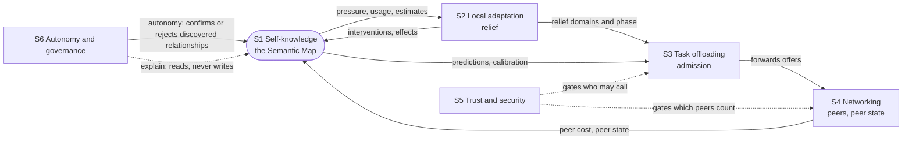

### What each subtask is, and what is open

**S1 · Self-knowledge.** Collectors produce typed samples; the state model admits any property it is sent, keeps an EMA and confidence per property, recomputes derived (construct) properties from their members, and holds per-workload properties as `metric_type@subject`. Silence makes a property stale and then retired; an observation revives it. The proposer pairs properties and offers candidate relationships; confirmed candidates become relationships with `Discovered` provenance. *Open:* the routing table and the construct vocabulary are still seeded from a domain spec.

**S2 · Local adaptation.** One relief loop per lever. Two levers exist: `memory.high` (cgroup v2) and `cpu.limit` (Kubernetes in-place resize). A loop enters *relieving* when its contention ratio stays above `Enter`, steps a cap down on the workload the map attributes most pressure to, verifies the effect after `Settle`, keeps or reverts it, and learns the effect. *Open:* no CPU-weight lever; relief is not gated by the autonomy reviewer — only `policy` rules and per-workload limits bound it.

**S3 · Task offloading.** A submitter offers a workload by name and demand. Each node answers from its own map, predicting the pressure each relief domain would reach; a node that declines forwards the offer to the next peer. Once the workload arrives, the node checks its own prediction and feeds the error into calibration. *Open:* the walk is in peer-id order and ignores trust; the agent never starts the workload itself.

**S4 · Networking and coordination.** A static registry (`peers.urls`, or `POST /peers`) of peer URLs. Agents query each other's `/cost`, forward `/offers`, and poll each other's `/state` into a `PeerStore` that is held apart from local state and never merged. *Open:* no discovery (mDNS/gossip is planned only); plain HTTP; one registry implementation, not yet a contract.

**S5 · Trust and security.** Trust is a number per peer in `[0, 1]`, moved by reachability (+0.05 when a peer answers `/cost`, −0.05 when the query fails other than by a 4xx) and by an operator. `RecommendPeer` ranks by `savings × trust` and skips peers under `min_trust`. Security is a scope decision: **no authentication on any endpoint**; the defences are a JSON content-type check against browser CSRF, node-local ingest (foreign samples rejected) and owner checks on peer state. *Open:* outcome-driven trust (accepted/declined offers, broken predictions) is not wired; admission does not read trust; no TLS, no peer identity, no authorisation.

**S6 · Autonomy and governance.** The autonomy reviewer decides on the proposer's candidates in tiers — rules, then a decision model, then a tool-using reasoner — bounded by `loops.review.level`. Every estimate, relief step, admission and review is a journalled decision whose inputs can be read back. `/explain` answers questions about the map through read-only tools, checked by a validator and a critic. *Open:* the reviewer governs discovery only, not actions; there is no AgentOps view across nodes.

---

## 2. The whole agent

### Context

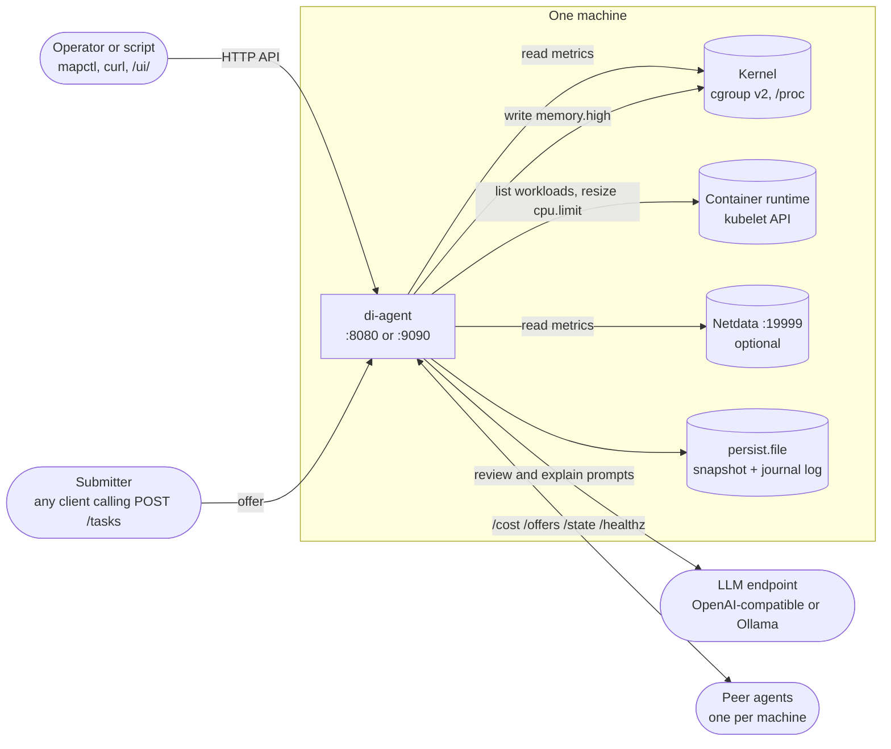

### Components

Grouped by subtask. Solid arrows are calls on the hot path; dotted arrows are reads for a decision.

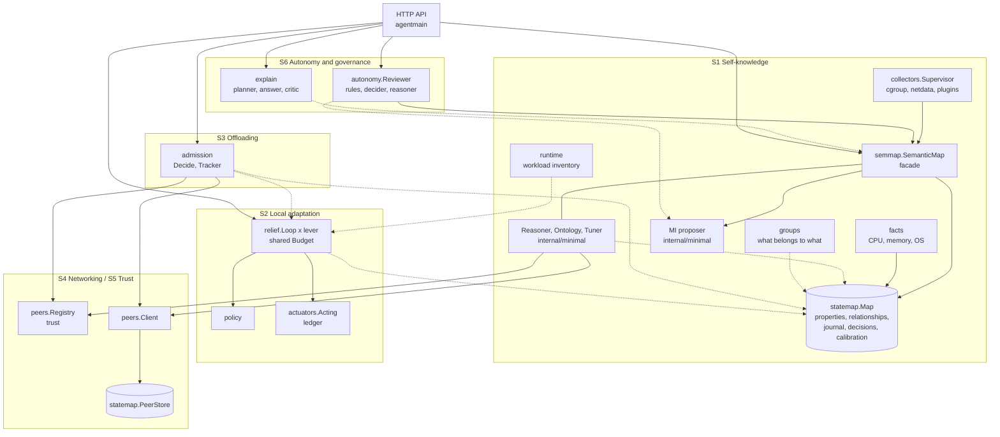

### The loops that run

All started from `agentmain.Main` (`pkg/agentmain/main.go`). "Paced" loops wait four times longer when the pace monitor reports the agent slow (`pkg/agentmain/pace.go`).

| Loop | Subtask | Default tick | Enabled by |
|---|---|---|---|
| Collection: `Collect` → `IngestSample` | S1 | 10 s, paced | `sources.collectors` (default `cgroup`), `sources.interval` |
| Lifecycle sweep: stale and retire | S1 | `stale_after/2`, at least 5 s | always; `map.sweep_interval` overrides the tick |
| Groups | S1 | 30 s, paced | `groups.interval` (0 turns it off) |
| Requests refresh | S1 | 30 s | a non-dry-run runtime |
| Relief, one per lever | S2 | 15 s | `loops.relief.enabled` |
| Admission tracker | S3 | relief interval | always built |
| Peer state poll | S4 | 30 s | `peers.state_poll` (0 turns it off) |
| Review | S6 | 1 min, paced | `loops.review.level` ≠ `off` (default `full`) |
| Pace monitor | — | 1 min | always |
| Save | — | 1 min, paced | `persist.file` |

---

## 3. Self-knowledge: the Semantic Map

### Telemetry into the map

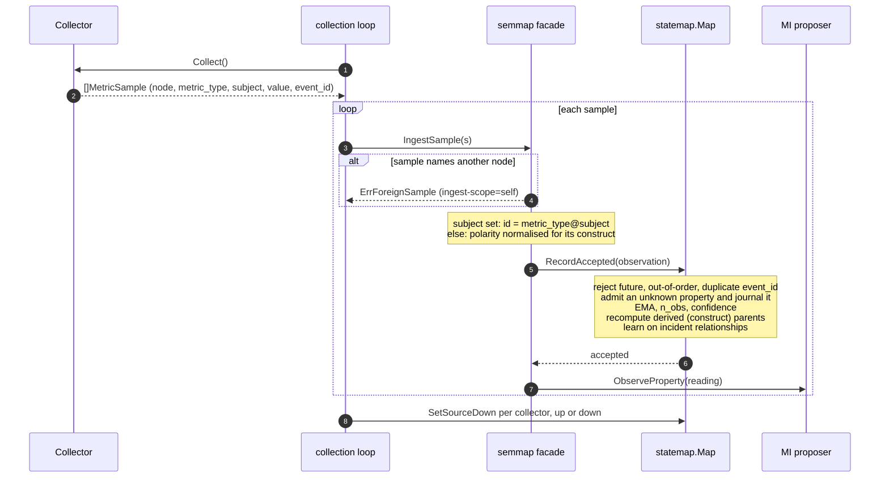

The same path serves `POST /ingest-sample`, so a sample sent over HTTP is treated exactly like a collected one.

### A property's life

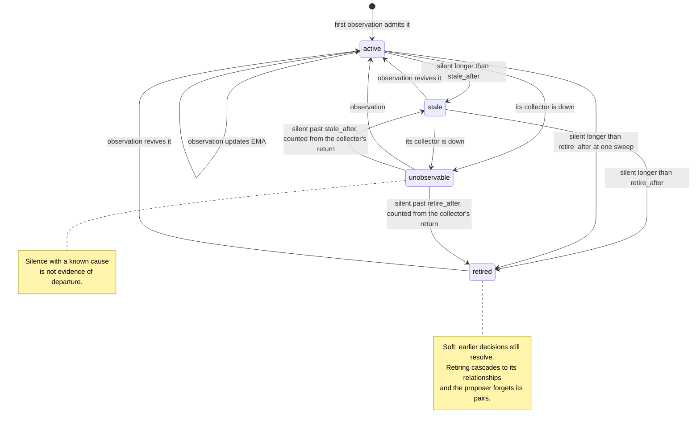

### Discovery: a candidate becomes a relationship

Two paths confirm a candidate — the operator over HTTP, or the autonomy reviewer ([§8](#8-autonomy-and-governance)). A relief intervention can also confirm one as reviewer `intervention` ([§4](#4-local-adaptation-relief)).

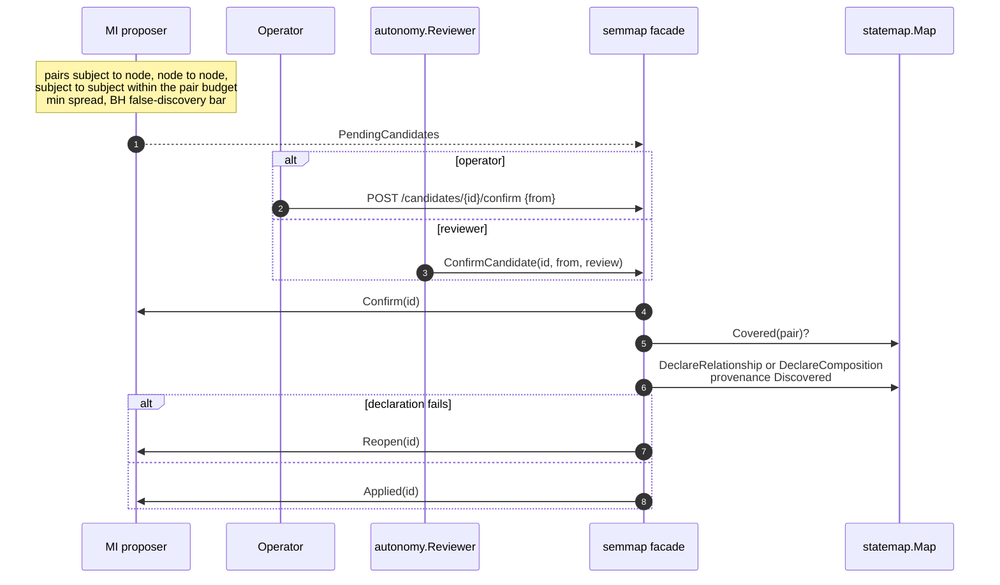

---

## 4. Local adaptation: relief

### Lever phase

One per relief loop (`pkg/relief/trigger.go`). Defaults: `cpu.limit` enters above contention 0.25 and exits below 0.10; `memory.high` enters above 0.08 and exits below 0.03. `EnterFor` 1 min, `ExitFor` 3 min. A reading that is not fresh holds the phase and breaks any run in progress.

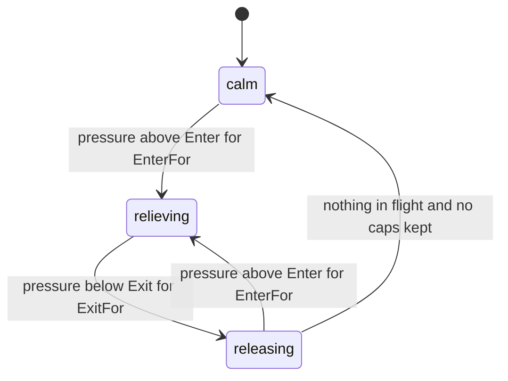

### One action

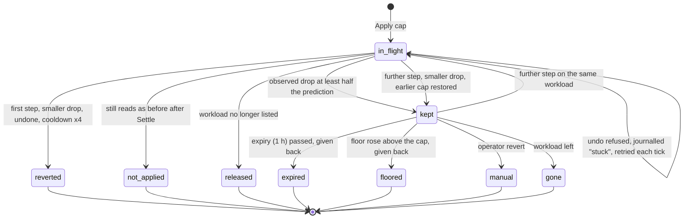

A refused give-back of a kept cap (at expiry, floor or a manual revert) is journalled `stuck` the same way and retried each tick; `stuck` is a decision, not an outcome.

### A relief episode

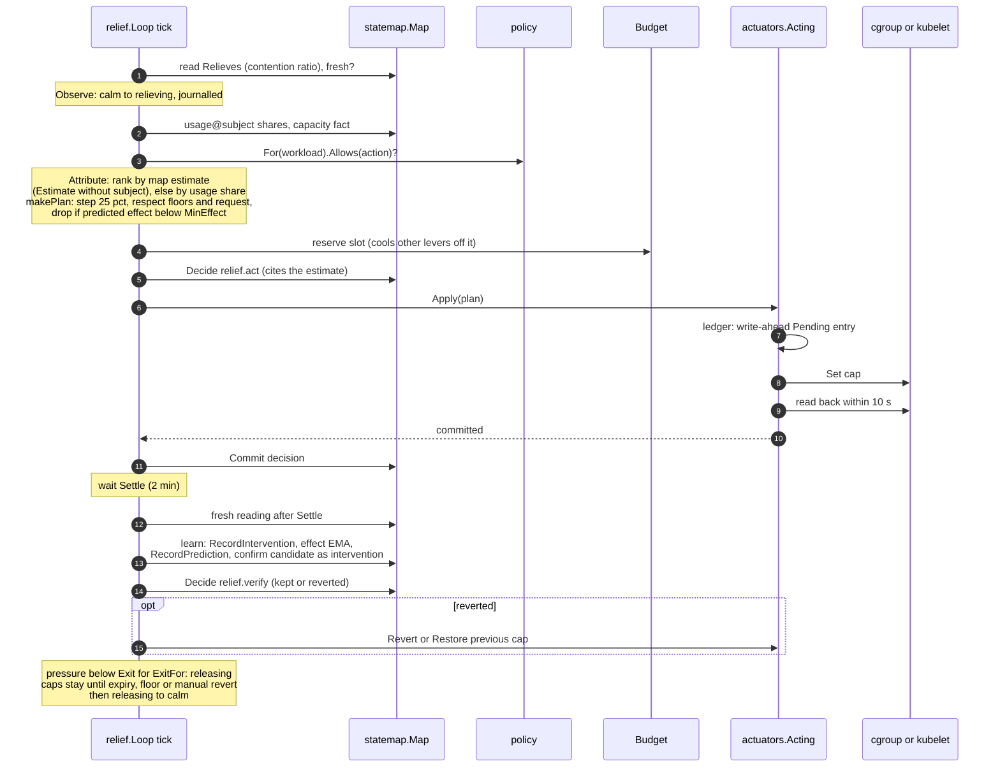

On restart, `Acting.Held` reads what the ledger holds and `reconcile` sorts the held entries by expiry: the latest-expiring one resumes as in flight (when nothing already is) and the rest as kept, while expired entries are taken as kept so that `expire` gives them back. Nothing new is applied until reconcile succeeds. `POST /relief/pause` stops new actions on every lever while the loops keep observing, verifying and expiring.

---

## 5. Task offloading: admission

There is no broker binary. Whichever agent receives `POST /tasks` is the submitter: it answers first, then walks its peers.

### An offer walks the chain

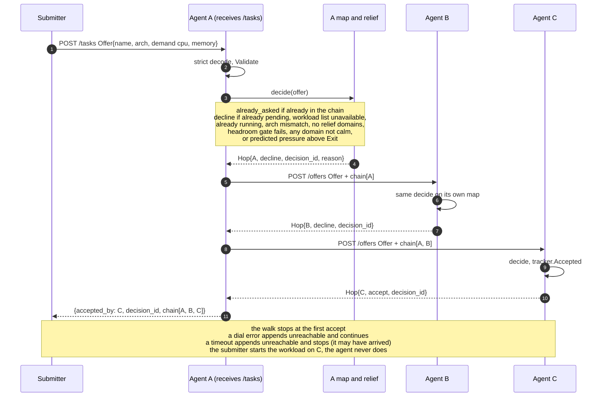

### How one node decides

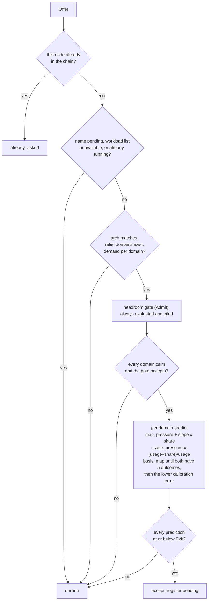

### Checking the prediction afterwards

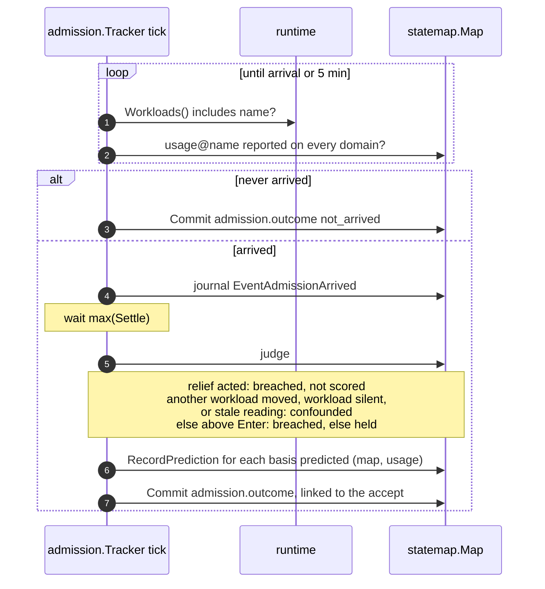

---

## 6. Networking and coordination

### What crosses between agents

Every agent exposes the same surface; there is no coordinator role in the agent.

| Call | Direction | Used by | Effect on the caller |
|---|---|---|---|
| `GET /cost?task=` | A to B | `RecommendPeer` (S5) | B answers for itself; reward B, or penalise it unless B answered 4xx |
| `POST /offers` | A to B | admission walk (S3) | appends B's hop to the chain |
| `GET /state` | A to B | peer state poll | stored in `PeerStore` under the node id B reports for itself |
| `GET /healthz` | any | probes | none |

### Peer state polling

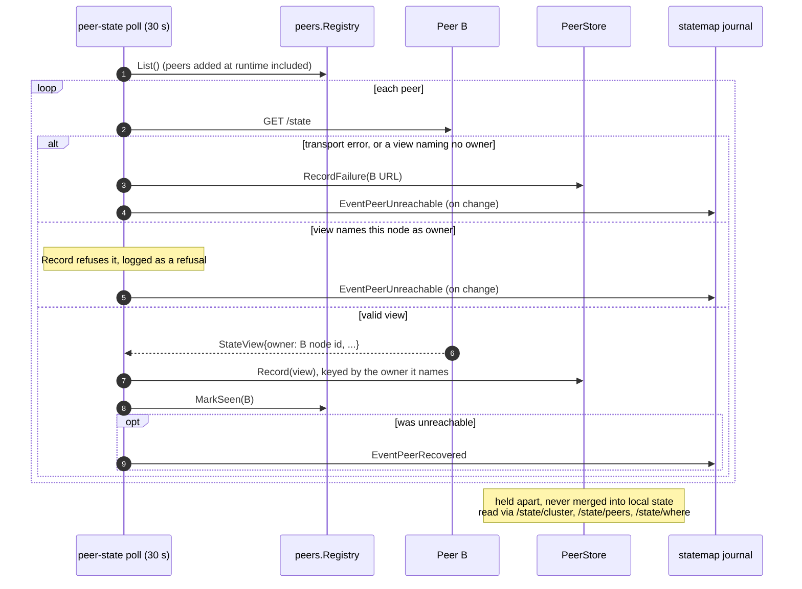

### Topology

Peers are a static, operator-built mesh: `peers.urls` at start, or `POST /peers` at runtime. The PoC scripts register every other agent on each node (full mesh) and set trust to 0.8. A peer's id is the first 12 hex digits of `sha256(url)`.

---

## 7. Trust and security

### Trust per peer

`Descriptor.Trust` in `[0, 1]` (`pkg/peers/peers.go`). Registered at 0.5. `TrustStep` is 0.05. The ranking floor is `profile.min_trust` (default 0.5). Trust survives a restart in the loops snapshot.

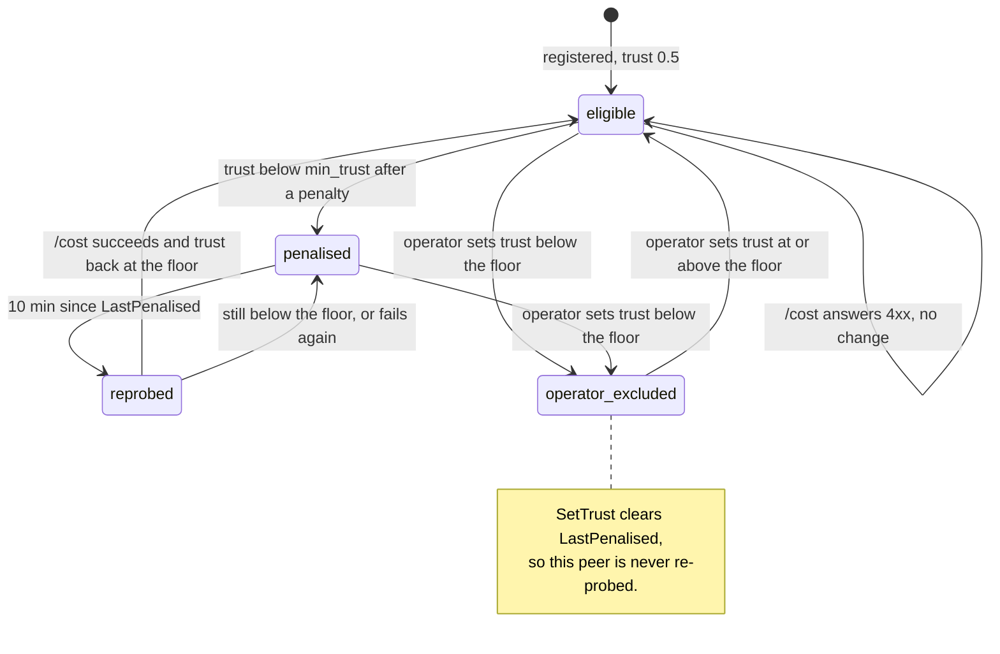

### Recommending a peer

`POST /recommend` → `RuleEngineReasoner.RecommendPeer` (`internal/minimal/reasoner.go`).

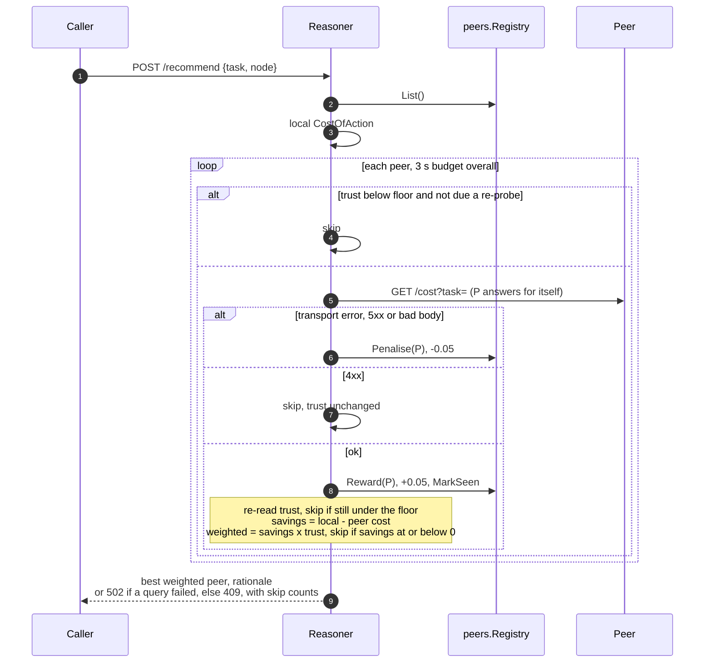

### Security boundary

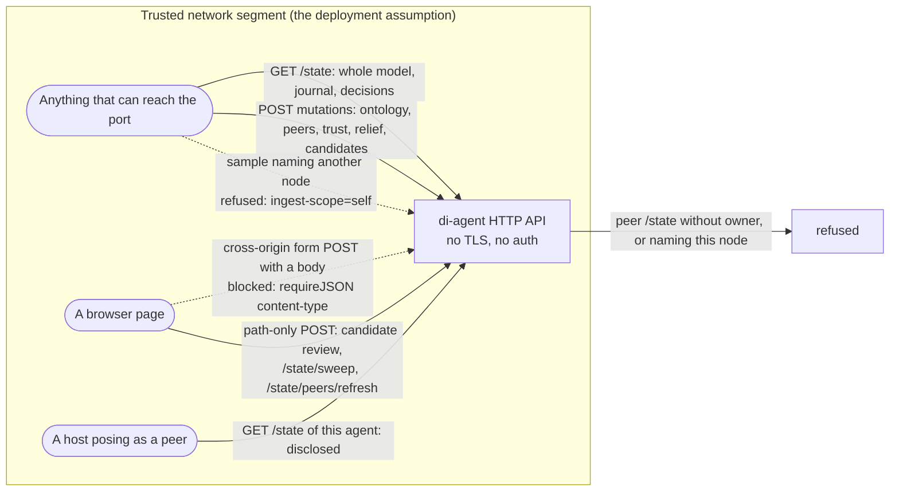

What exists today, and what does not:

| Defence | Where | Protects against |
|---|---|---|
| `requireJSON` on every POST that takes a body, `/recommend` and `/simulate` included | `pkg/agentmain/routes.go` | browser CSRF against a daemon on localhost |
| Foreign samples refused | `semmap.IngestSample`, `node.ingest_scope: self` | one node writing another's state |
| Peer state must name an owner, not this node | `peers.Client.State`, `statemap/peer.go` | a peer's view being mistaken for local state |
| Strict offer decoding | `readOffer`, `pkg/agentmain/admission.go` | a misspelt field read as zero demand |
| Snapshot owner check | `statemap/persist.go`, when `persist.file` is loaded | restoring another node's state |
| `policy` freeze rules, self always frozen | `pkg/policy` | relief acting on system or protected workloads |
| **Not covered:** path-only POSTs (`/candidates/{id}/{confirm,reject,defer}` without a body, `/state/sweep`, `/state/peers/refresh`) | `pkg/agentmain` | a forged form post can trigger them; candidate ids are unguessable in practice, and the other two only run early what a loop runs anyway |
| **Missing:** authentication, TLS, peer identity, authorisation | — | everything that can reach the port can read and mutate |
| **Missing:** outcome-driven trust | `Registry.UpdateTrust` exists, nothing calls it on an offer outcome | a peer that accepts and then breaks its prediction keeps its trust |

The no-auth stance is a recorded scope decision for a lab network ([`OPERATING.md`](../OPERATING.md#read-this-first), ARCHITECTURE §10).

---

## 8. Autonomy and governance

### Review levels

`loops.review.level` (default `full`; the PoC2 chart sets `rules`).

| Level | Applies |
|---|---|
| `off` | no reviewer built |
| `suggest` | nothing; annotates candidates |
| `rules` | tier 0 rules only |
| `bounded` | everything except a model reject |
| `full` | everything |

### A review cycle

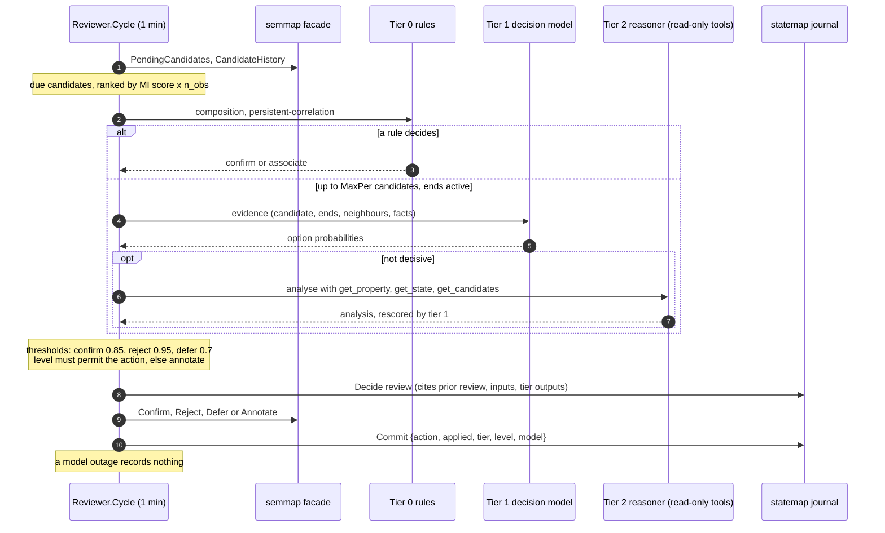

### A grounded answer, reproduced later

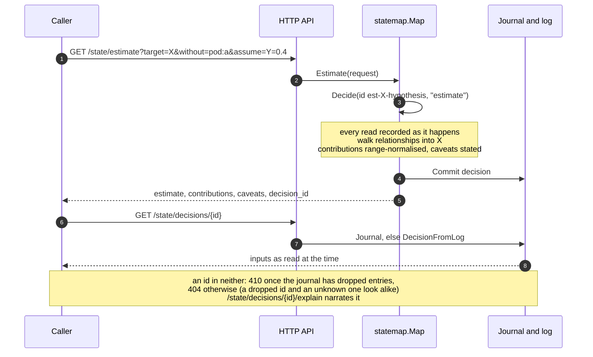

Relief steps (`relief.act`, `relief.verify`, …), admissions (`admission`, `admission.outcome`) and reviews (`review`) are decisions of the same kind, so each can be read back the same way.

### Asking in natural language

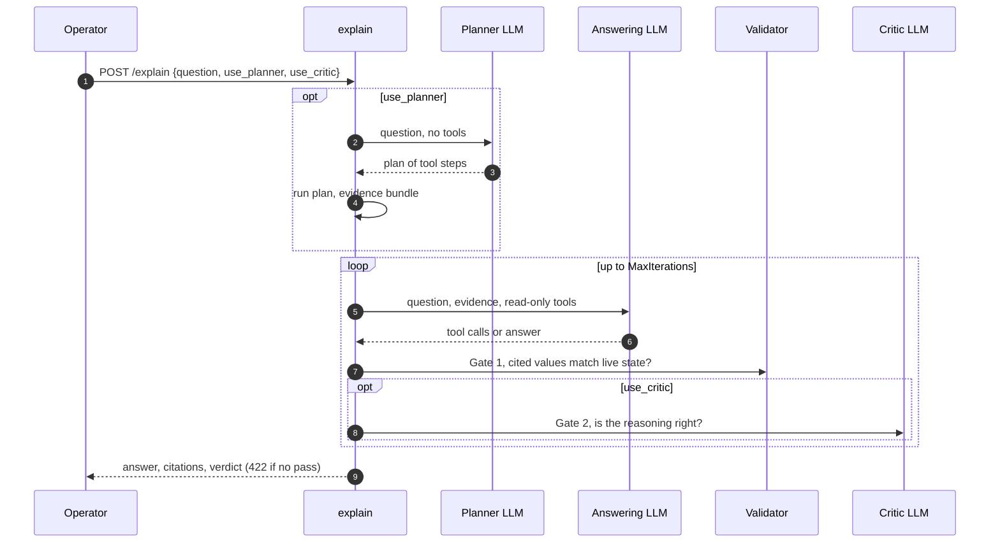

The explain LLM never writes. The autonomy reviewer's model can, within its level — that is the one place a model changes the map, and every such change is a journalled `review` decision.

---

## 9. Deployments

### `poc/` — three VMs, one agent each

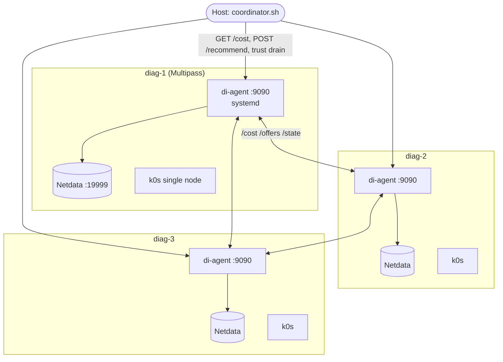

The case study (`poc/casestudy/`) is one VM, `di-node`, running k0s, Netdata, the agent with the Kubernetes runtime, and Ollama as the tier-1 decision model. The config changes by phase: `agent.yaml` has relief off, `agent-relief.yaml` turns it on from phase P3, and `master.sh` runs `agent-autonomous.yaml` and submits offers via `POST /tasks`.

### `poc2/` — Kubernetes, replayed and live telemetry

```mermaid
flowchart LR
    subgraph infra["libvirt: 4 VMs via Terraform, VM 1 the control plane; or EKS: 3 x t3.medium"]
        subgraph sys["Helm chart di-agent-system"]
            pg[("PostgreSQL")]
            ing["postgres-ingest Job"]
            rs["replay-streamer"]
            kf[("Kafka<br/>dataset.telemetry")]
            dc["dataset-collector :8000"]
            tw["telemetry-writer"]
            ix[("InfluxDB")]
            gf["Grafana"]
            pr["Prometheus"]
            pb["pontos-bridge<br/>optional"]
        end
        subgraph ds["di-agent DaemonSet, hostNetwork, workers only"]
            w1["agent worker-1 :9090"]
            w2["agent worker-2 :9090"]
            w3["agent worker-3 :9090"]
        end
    end
    sp(["Dataset CSVs"]) -->|skipped when PONTOS is on| ing --> pg --> rs --> kf
    pon(["PONTOS MQTT"]) --> pb --> kf
    kf --> tw --> ix --> gf
    kf --> dc
    w1 -->|POST /collect, designated node| dc
    pr -->|scrape /metrics| rs
    gf --> pr
    w1 <-->|full mesh, trust 0.8| w2
    w2 <--> w3
    w1 <--> w3
    host(["Host: 04-peers.sh, coordinator.sh"]) --> ds
```

Every agent also reads the host's `/sys/fs/cgroup` and keeps state under `/var/lib/di-agent`. Only the node named by `agent.datasetNodeName` collects from `dataset-collector`; the default is empty, so dataset collection is off until it is set (`04-peers.sh` requires it). The agent DaemonSet runs on the three workers.
